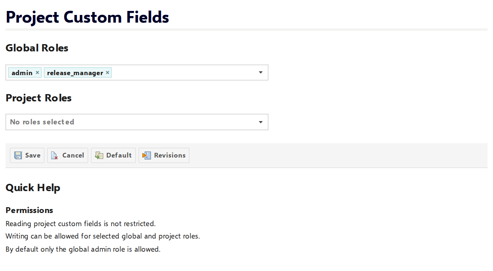
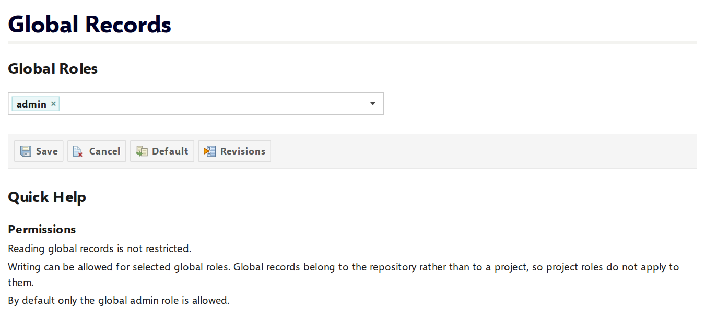

# User Guide

How to store your own values in Polarion projects and in the repository, and who may change them. For the first
steps see the [quick start page](QUICK_START.md); scripts read and write the same values through the
[REST API](REST_API.md).

## Table of contents

* [What the extension adds](#what-the-extension-adds)
* [Project custom fields](#project-custom-fields)
* [Global records](#global-records)
* [Reading and writing values](#reading-and-writing-values)
    * [Values in Velocity scripts](#values-in-velocity-scripts)
    * [Writing values from a Live Report Page](#writing-values-from-a-live-report-page)
* [Who may write](#who-may-write)

## What the extension adds

| Feature                                       | Where                                                           | Described in                        |
|-----------------------------------------------|-----------------------------------------------------------------|-------------------------------------|
| Project custom fields                         | Velocity scripts, REST API                                      | This page                           |
| Global records                                | Velocity scripts, REST API                                      | This page                           |
| `$collectionsTool` and `$regexTool`           | Velocity scripts, REST API (`$regexTool`)                       | [Velocity tools](VELOCITY_TOOLS.md) |
| Apache Velocity Tools 3 as `$velocityToolsV3` | Velocity scripts                                                | [Velocity tools](VELOCITY_TOOLS.md) |
| Velocity Engine 2.4.1 for scripts             | Live Report Page widgets, LiveDoc documents, Classic Wiki Pages | [Velocity 2](VELOCITY_2.md)         |

The administration has the node `API Extender` with these pages:

| Page                    | Scope                  | Purpose                                                                   |
|-------------------------|------------------------|---------------------------------------------------------------------------|
| `About`                 | Repository and project | Version of the extension and general information.                         |
| `REST API`              | Repository and project | Swagger UI with all [REST endpoints](REST_API.md).                        |
| `Project Custom Fields` | Repository and project | Roles which may [write project custom fields](#who-may-write).            |
| `Global Records`        | Repository             | Roles which may [write global records](#who-may-write).                   |
| `Documentation`         | Repository and project | This documentation.                                                       |

## Project custom fields

Polarion has no custom fields for projects. The extension adds them: a project can store any number of values,
each under a key of your choice, for example `release_manager` or `deployment_url`.

- The values are stored in the file `.polarion/polarion-project.xml` of the project, next to the standard fields of
  the project such as `name` and `description`. They are versioned like every other file of the repository.
- A value is a string. Writing a key which exists replaces its value.
- Removing a key deletes its value. Reading a key which has no value finds nothing: Velocity gets no object, and the
  REST API answers `404`.
- The standard fields of a project cannot be written: the REST API answers `400` with
  `'<key>' is a standard field of project`. They can be read, for example the key `name` gives the name of the
  project.

> [!WARNING]
> A write saves the whole file again with only the `id` and the value of each field. Other attributes of the
> standard fields are lost, for example `text-type="text/plain"` of `description`.

## Global records

A global record is the same as a project custom field, but it belongs to the whole repository instead of to one
project: there is one value per key for all projects.

The values are stored in the file `.polarion/records.xml` at the root of the repository. The file is created by the
first write.

## Reading and writing values

Project custom fields and global records are read and written in the same ways:

| Way                                                     | Read | Write | Roles checked on write |
|---------------------------------------------------------|------|-------|------------------------|
| Velocity in a Live Report Page                          | Yes  | No    | -                      |
| Velocity in a LiveDoc document ("Wiki Content" block)   | Yes  | Yes   | No                     |
| Velocity in a Classic Wiki Page                         | Yes  | Yes   | No                     |
| [REST API](REST_API.md), also from a script on a page   | Yes  | Yes   | Yes                    |

The roles are the ones of [Who may write](#who-may-write).

### Values in Velocity scripts

Two objects give Velocity scripts access to the values:

| Object                 | Method                                         | Result                                                               |
|------------------------|------------------------------------------------|----------------------------------------------------------------------|
| `$customFieldsProject` | `getCustomField(projectId, key)`               | The field, or nothing if the project has no value for the key.       |
| `$customFieldsProject` | `setCustomField(projectId, key, value)`        | Writes the value. Not available in Live Report Pages.                |
| `$globalRecords`       | `getRecord(key)`                               | The record, or nothing if there is no value for the key.             |
| `$globalRecords`       | `setRecord(key, value)`                        | Writes the value. Not available in Live Report Pages.                |
| both                   | `getVersion()`                                 | The version of the extension.                                        |

The field and the record have the value in `value`, the same as `getValue()`. A project which does not exist makes
the call fail.

Read a project custom field, for example in a Live Report Page:

```velocity
#set($field = $customFieldsProject.getCustomField('elibrary', 'release_manager'))
#if($field)
    Release manager: $field.value
#end
```

Read the same key of all projects in a Classic Wiki Page:

```velocity
#foreach($project in $projectService.searchProjects('', 'id'))
    #set($field = false)
    #set($field = $customFieldsProject.getCustomField($project.id, 'release_manager'))
    #if($field)
        $project.id: $field.value<br>
    #end
#end
```

Read a global record, and show the version of the extension:

```velocity
#set($record = $globalRecords.getRecord('support_contact'))
#if($record)
    Support: $record.value
#end
API Extender version: $globalRecords.getVersion()
```

Write values in a LiveDoc document or a Classic Wiki Page:

```velocity
$customFieldsProject.setCustomField('elibrary', 'release_manager', 'jdoe')
$globalRecords.setRecord('support_contact', 'support@example.com')
```

> [!IMPORTANT]
> A write call runs each time the page is rendered, for every user who opens it, with the Polarion permissions of
> this user. The roles of the [Who may write](#who-may-write) pages are not checked. To remove a value, use the
> [REST API](REST_API.md).

To write a value only once, add the call to a Classic Wiki Page, save the page, then remove the call and save the
page again. The value stays stored.

### Writing values from a Live Report Page

In a Live Report Page the objects are read-only. A script on the page can write with the REST API instead: the
browser sends the request with the session of the user, so the `/internal` path of the API is used and no token is
necessary. The [roles](#who-may-write) are checked.

```html
<input id="cf_value" type="text" value="jdoe"/>
<button onclick="saveReleaseManager()">Save</button>
<script>
    function saveReleaseManager() {
        const value = document.getElementById('cf_value').value;
        const url = '/polarion/api-extender/rest/internal/projects/elibrary/keys/release_manager';
        const request = value
            ? {method: 'POST', headers: {'Content-Type': 'application/json'}, body: JSON.stringify({value: value})}
            : {method: 'DELETE'};
        fetch(url, request)
            .then(response => response.ok ? 'Saved' : response.text().then(text => response.status + ' ' + text))
            .then(text => alert(text));
    }
</script>
```

An empty value removes the key. For a global record, use the URL
`/polarion/api-extender/rest/internal/records/<key>`.

## Who may write

Reading project custom fields and global records is not restricted.

Writing through the [REST API](REST_API.md) is allowed only for some roles. Two pages of `API Extender` select
them, each for its own kind of value. By default only the global `admin` role may write.

Velocity scripts write without this check, with the Polarion permissions of the user who renders the page. See
[Values in Velocity scripts](#values-in-velocity-scripts).

**Project Custom Fields.** On the repository level the page selects global roles, for all projects. On the project
level it selects global roles and the roles of this project, for this project only. A project without its own
setting uses the setting of the repository.



Here the global roles `admin` and `release_manager` may write the project custom fields of the project.

**Global Records.** The page exists only on the repository level and selects global roles: global records belong to
no project, so project roles do not apply to them.



Here only the global role `admin` may write global records, which is the default.

Select the roles and press `Save`. `Cancel` goes back to the saved state, `Default` loads the default (the global
`admin` role) and `Revisions` shows the earlier states of the setting. A loaded state takes effect after `Save`.

> [!IMPORTANT]
> The permission check compares the setting with the **global** roles of the user. A project role selected on the
> `Project Custom Fields` page, for example `project_admin`, currently does not allow its users to write.
