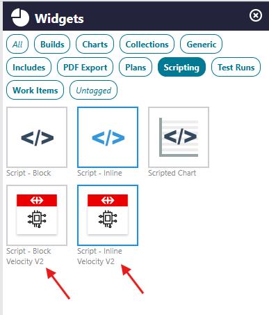
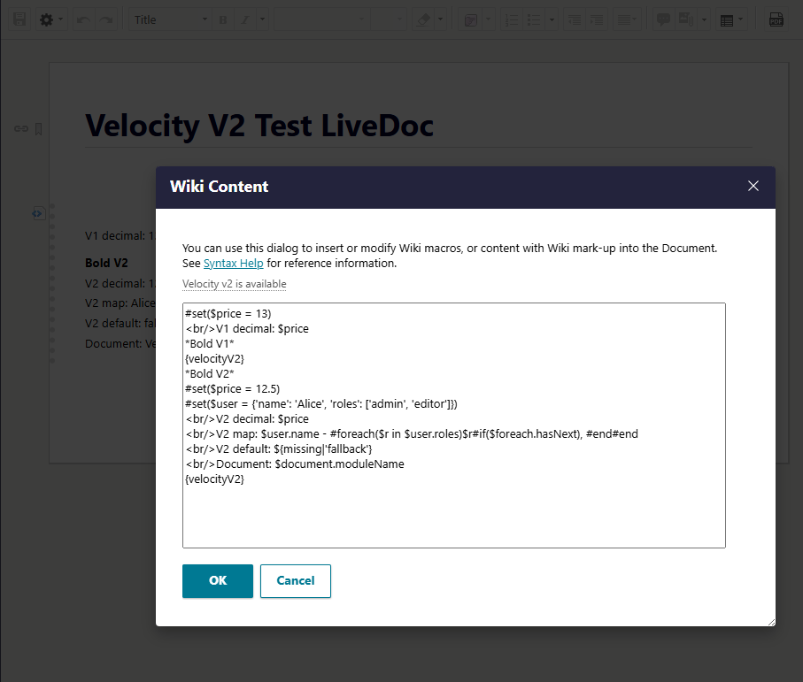
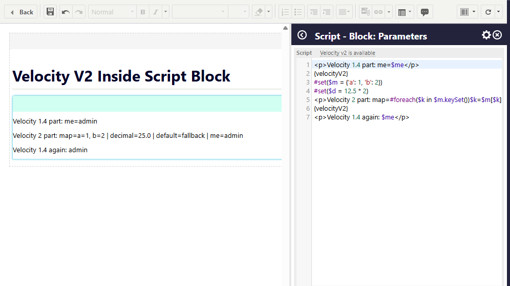
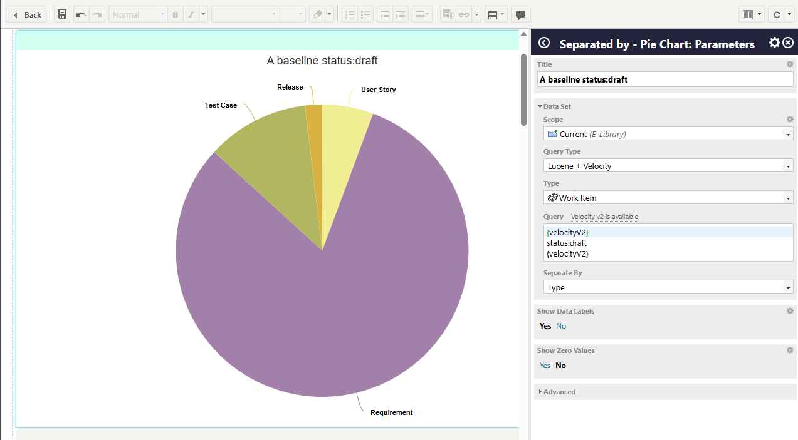
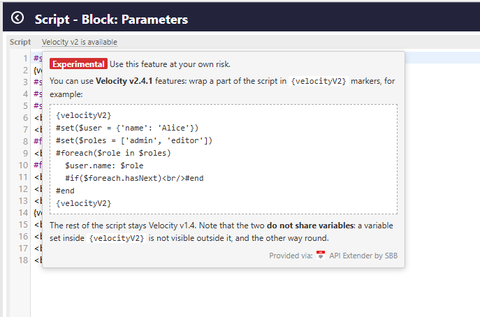

# Velocity 2

> [!WARNING]
> Experimental. Use the Velocity 2 widgets and the `{velocityV2}` regions at your own risk.

Polarion renders Velocity scripts with Velocity Engine 1.4. The extension adds Velocity Engine 2.4.1, which a script
can use in these places:

| Place                                              | How                                                                                             |
|----------------------------------------------------|-------------------------------------------------------------------------------------------------|
| Live Report Pages                                  | The [Velocity 2 script widgets](#script-widgets-with-velocity-2): the whole script is Velocity 2. |
| LiveDoc documents and Classic Wiki Pages           | [`{velocityV2}` regions](#velocity-2-in-livedoc-documents-and-classic-wiki-pages) in the content. |
| Polarion Script widgets of Live Report Pages       | [`{velocityV2}` regions](#velocity-2-regions-in-the-polarion-script-widgets) in the script.     |
| Queries of Live Report Page widgets                | [`{velocityV2}` regions](#velocity-2-regions-in-widget-queries) in the query.                   |
| A single template string, on any page              | The [`render` tool](VELOCITY_TOOLS.md#render) of `$velocityToolsV3`.                            |

Velocity 2 adds syntax which Velocity v1.4 does not have, for example:

- map literals: `#set($colors = {'open': 'red', 'done': 'green'})`,
- index notation: `$list[0]`, `$colors['open']`,
- `#break` to leave a `#foreach` loop,
- default values: `${owner|'nobody'}`,
- the loop helper `$foreach`: `$foreach.index`, `$foreach.hasNext`, `$foreach.first`, `$foreach.last`,
- decimal number literals such as `12.5`.

## Script widgets with Velocity 2

The `Script - Block Velocity V2` and `Script - Inline Velocity V2` widgets of Live Report Pages render a Velocity script with Velocity Engine 2.4.1, which is part of this extension.
They are the same as the Polarion `Script - Block` and `Script - Inline` widgets, but the script can use the [Velocity 2 syntax](https://velocity.apache.org/engine/2.4.1/user-guide.html).

Add the widgets from the `Scripting` group of the widget sidebar.
Like the Polarion widgets, they are restricted widgets.



The script gets the same variables as in the Polarion widgets, for example `$transaction`, `$page`, `$widgetContext`, `$trackerService`, `$pageParameters` and `$velocityToolsV3`.

```velocity
#set($limit = 2.5)
#set($ids = ['WI-1', 'WI-2'])
#set($colors = {'open': 'red', 'done': 'green'})
#foreach($id in $ids)$id#if($foreach.hasNext), #end#end
$colors.open $limit
```

> [!IMPORTANT]
> Limitations:
> - `#parse` and `#include` are not available. The engine cannot read the scripts in `.polarion/pages/scripts/velocity`.
> - The Polarion global macros, for example `#info`, `#warning` and `#loadJs`, are not available.
> - A `#macro` is available only inside the widget that defines it.
> - Velocity 2 changes some behavior of Velocity v1.4, for example whitespace handling and empty values in `#if`. See the [Velocity 2.0 upgrade notes](https://velocity.apache.org/engine/2.0/upgrading.html).
> - Reflection is blocked, for example `$s.class.forName(...)` and `$s.class.classLoader`, and so are classes such as `System`, `Runtime` and `Thread`.
> - A script error shows a warning in the widget. The Polarion log contains the error and the script.

## Velocity 2 in LiveDoc documents and Classic Wiki Pages

A "Wiki Content" block of a LiveDoc document and the content of a Classic Wiki Page can contain Velocity 2 regions.
Write the region between two `{velocityV2}` markers:

```velocity
Velocity v1.4 renders this line: #set($sum = 1 + 2)$sum
{velocityV2}
#set($colors = {'open': 'red', 'done': 'green'})
#foreach($state in $colors.keySet())$state: $colors[$state]#if($foreach.hasNext), #end#end
<br/>Price: #set($p = 12.5)$p
{velocityV2}
```

The rest of the content stays Velocity v1.4. The content can contain more than one region.
Wiki markup and wiki macros apply to the output of a region, the same as to Velocity v1.4 output, for example `1 Heading`, `*bold*` or `{workitem:WI-1}`.



The region gets these variables:

- The objects of the Classic Wiki Page rendering context, for example `$trackerService`, `$projectService`, `$velocityToolsV3` and `$globalRecords`.
- `$transaction`: the current transaction. Like in Velocity v1.4, a new one is created if none exists.
- The same XWiki objects as in Velocity v1.4: `$request`, `$response`, `$xwiki`, `$context`, `$pageParameters`, `$esc`, `$msg` and `$localization`.
- In LiveDoc documents: `$document`, the document as `IModule`.
- In Classic Wiki Pages: `$page` and `$doc`, the same objects as in Velocity v1.4.

All regions of a LiveDoc document share one context, in the order of the blocks.
All regions of a Classic Wiki Page share one context. An included page has its own context.

Velocity v1.4 gets the output of a region as a value, so the script can use it in a double-quoted string:

```velocity
#set($label = "{velocityV2}#set($m = {'a': 'x'})$m.a{velocityV2}")
#if($label == 'x')Velocity v1.4 compares the output of the region.#end
```

The same applies to the regions in the Polarion Script widgets.

> [!IMPORTANT]
> Limitations:
> - A region does not see the variables which Velocity v1.4 sets with `#set`, and Velocity v1.4 does not see the variables which a region sets.
> - In a LiveDoc document, all regions render when Velocity v1.4 inserts the first region output. If Velocity v1.4 skips all regions, for example in an `#if` branch, no region renders.
> - In a Classic Wiki Page, all regions render before Velocity v1.4, so a region also renders in an `#if` branch which Velocity v1.4 skips.
> - A region cannot contain a `{velocityV2}` marker, and it must end in the block where it starts. Without a closing marker in the same block, the marker stays as text and Velocity v1.4 renders the content.
> - Do not put a region in a single-quoted Velocity v1.4 string. Velocity v1.4 does not insert the output there.
> - A `#macro` is available only inside the region that defines it.
> - `#parse`, `#include` and the Polarion global macros are not available.
> - Reflection is blocked, the same as in the Velocity 2 widgets.
> - A script error shows the message `Velocity 2 error: ...` in place of the region. The Polarion log contains the error and the script.
> - Without this extension, Polarion renders the region with Velocity v1.4.
> - Classic Wiki Pages support regions within 10 seconds after the first wiki page opens after a Polarion start, and after a reset of the wiki cache. Until then, Velocity v1.4 renders the regions.

## Velocity 2 regions in the Polarion Script widgets

The script of the Polarion `Script - Block` and `Script - Inline` widgets can also contain `{velocityV2}` regions.
The region renders with Velocity Engine 2.4.1, and the rest of the script stays Velocity v1.4.
The same applies to every widget with a script parameter, for example `Scripted Chart`.

```velocity
<p>Velocity v1.4 renders this line: $me</p>
{velocityV2}
#set($colors = {'open': 'red', 'done': 'green'})
<p>#foreach($state in $colors.keySet())$state: $colors[$state]#if($foreach.hasNext), #end#end</p>
{velocityV2}
```

The region gets the same variables as the script, for example `$transaction`, `$page` and `$widgetContext`.
All regions of one script share one context.
The [limitations](#velocity-2-in-livedoc-documents-and-classic-wiki-pages) of the Velocity 2 regions in LiveDoc documents and Classic Wiki Pages apply, except that no wiki markup is involved.
All regions render before Velocity v1.4 renders the script, so a region also renders when it is in an `#if` branch which Velocity v1.4 skips.



> [!IMPORTANT]
> The extension changes the bytecode of the Polarion class which renders these scripts, when Polarion loads the class.
> So the regions work after a Polarion restart with the extension installed.
> If the extension is installed for the first time by a hot deploy onto a running Polarion, the regions work after the next restart.
> The Polarion log then contains `Velocity 2 rendering of {velocityV2} regions in LiveReport scripts is installed`.

## Velocity 2 regions in widget queries

The "Query" of a widget Data Set parameter can contain `{velocityV2}` regions when "Query Type" is "Lucene + Velocity" or "SQL + Velocity".
The region renders with Velocity Engine 2.4.1, and the rest of the query stays Velocity v1.4.
The same applies to every widget with a Data Set parameter, for example `Separated by - Pie Chart`.

A Lucene query:

```velocity
type:requirement AND {velocityV2}#set($m = {'s': 'draft'})status:$m.s{velocityV2}
```

The last part of an SQL query, after `where true`:

```velocity
{velocityV2}#set($types = ['requirement', 'task'])and WORKITEM.C_TYPE IN (#foreach($t in $types)'$t'#if($foreach.hasNext), #end#end){velocityV2}
```

The region gets the same variables as the query, for example `$transaction`, `$pageParameters` and `$widgetContext`.
A page parameter in a region renders as Lucene or as SQL, the same as in Velocity v1.4.
All regions of one query share one context.
Velocity v1.4 gets the output of a region as text: it does not evaluate `$` and `#` in the output.



> [!IMPORTANT]
> Limitations:
> - A region does not see the variables which Velocity v1.4 sets, and Velocity v1.4 does not see the variables of a region.
> - In an SQL query, a region must stay inside one of the three parts which the widget shows for editing.
> - A script error in a region shows `Velocity 2 error:` and the message in the widget. The Polarion log contains the query.
> - When "Query Type" changes from "Lucene" to "Lucene + Velocity", Polarion replaces `$` with `${esc.d}` and `#` with `${esc.h}` in the query. Type the region again after this change.
> - The extension changes the bytecode of the Polarion class which renders these queries, when Polarion loads the class.
>   So the regions work after a Polarion restart with the extension installed.
>   The Polarion log then contains `Velocity 2 rendering of {velocityV2} regions in widget queries is installed`.

## Hints in the user interface

These places show "Velocity v2 is available". Hover the text to see an example of a `{velocityV2}` region:

- LiveDoc "Wiki Content" dialog: below the Syntax Help link.
- Classic Wiki Page in edit mode: in the Wiki Markup formatting toolbar, after the last button.
- LiveReport "Script - Block" and "Script - Inline" widgets: in the parameters sidebar, next to the "Script" header.
- LiveReport widgets with a Data Set parameter: in the parameters sidebar, next to the "Query" header, when "Query Type" is "Lucene + Velocity" or "SQL + Velocity".



The "Script - Block Velocity V2" and "Script - Inline Velocity V2" widgets show no hint: their names already say "Velocity V2".

The extension adds the hints with a script, which Polarion loads into every page through the `com.polarion.portal.tomcat.externalJsFile` extension point.
No administrator configuration is necessary.
